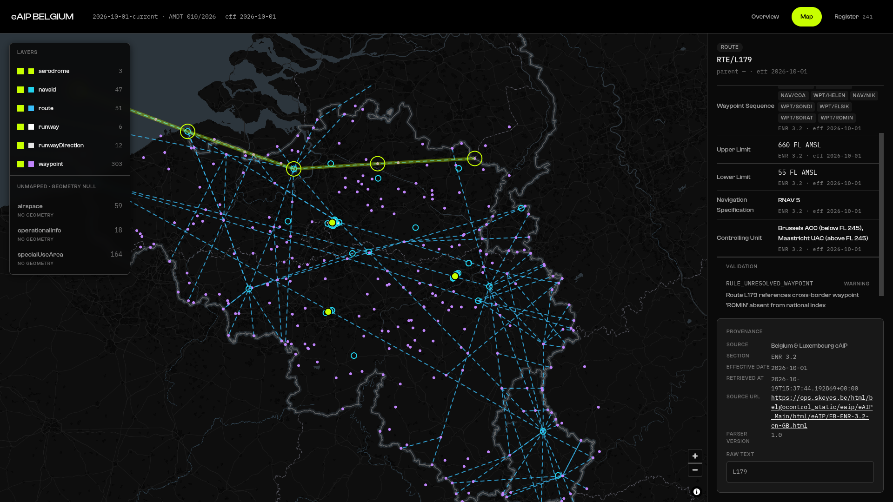
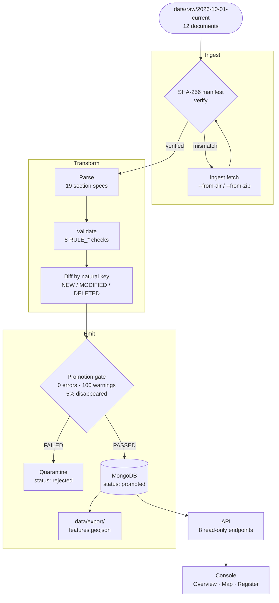

<p align="center">
    
</p>
<h1 align="center">eAIP Belgium</h1>
<p align="center">Aeronautical data from the official Belgium and Luxembourg Electronic Aeronautical Information Publication (eAIP)</p>

<a href="https://aip.ishu.foo/"></a>

<p align="center">
    
</p>

> **Note**: Declaration for generative AI use - @nooroid is the alias I have given to my personal agent, all of the commits were authored, tested, and reviewed by myself.

## Table of contents
1. [Overview](#overview)
2. [Architecture](#architecture)
3. [Execution setup](#execution-setup)
4. [Configuration](#configuration)
5. [Built with](#built-with)
6. [Known limitations](#known-limitations)

## Overview
This system, as presented, ingests, validates and diffs the official Belgium and Luxembourg Electronic Aeronautical Information Publication (eAIP) published by (skeyes)[https://www.skeyes.be/] across consecutive 28-day AIRAC cycles.

The main goal here was to convert unstructured HTML tables into structured, cryptographically fingerprinted (and hence verifiable) aeronautical features with complete information about where they came from (provenance). When a new cycle is published, this system isolates changes down to the individual field modifications (ex. reduced runway LDA) and halts promotion if safety-critical invariants are violated.

## Architecture
For detailed information, see `architecture.typ`/PDF. A diagram for its working is given below. For _why_ a certain decision was made, see [`DECISION_LOG.md`](DECISION_LOG.md).


## Execution setup
One can either use Docker or follow the steps manually. Both are supported. I will be making two assumptions: first, that they have `uv` installed, and second, that they have `npm` installed. Additionally, for Docker support, `docker compose` needs to be installed too. On some systems, the `docker-buildx` package is required for latest support.

The exection is streamlined via the presence of a "master script", [start.sh](./start.sh). The Docker pathway utilises it to get everything set up from a single command. Manually populating the pipeline is also fully supported. 

First, clone the repository:
```bash
git clone https://github.com/cosmognaut/ifoa-assignment.git
cd ifoa-assignment
```
From now on I will be assuming you're in the repo root itself.

The map in the web UI uses CARTO's dark basemap. Without a key it renders _raster_ tiles; with one it renders _vector_ tiles. Everything else is identical. Whatever method you choose to follow, the CARTO key is optional. To set it:

- `cp .env.example .env`, set `VITE_CARTO_API_KEY` 
- `docker compose up -d --build`. 

A rebuild is required; Vite inlines the key at build time, so restarting the container changes nothing.

### Option A: Using the master script
This makes use of `start.sh`. It refuses to start the API unless the pipeline both exits zero and prints `status: promoted`. A quarantined cycle exits successfully, so an exit-code check alone would launch a console over a rejected publication. Run this:

```bash
chmod +x start.sh
./start.sh
```
That's literally it. Now wait for it to populate the data, spin up the containers and start the web UI. Visit `http://localhost:3000/` to verify that this is working. This single script:

- builds the images for the API and the pipeline
- starts MongoDB
- ingests the current cycle
- validates it and persists it to the DB
- starts the API and the webUI

### Option B: Manual setup
You can choose to set everything up manually for more fine-grained control (for ex. choosing which cycle to persist, etc.)

#### Part A: Loading a cycle
The CLI (`pipeline/cli.py`) makes it convenient to do this.
1. First, check for publisher updates:
```bash
uv run -m pipeline.cli check-updates
```
This command checks the AIP updates from the publisher's website (skeyes). It would automatically tell you about a new cycle and which ones require ingestion.
(_Hint_: for more about the CLI itself, use `uv run -m pipeline.cli --help`)

2. Fetch a cycle, which downloads the raw HTML byte-for-byte with polite 1req/s rate limits:
```bash
uv run -m pipeline.cli fetch --cycle 2026-10-01-current
```
> **Note**: ingest cycles reports `2026-10-01` for the current edition while this snapshot is keyed `2026-10-01-current`. These are the SAME edition, the suffix exists because current and previous share an effective date (see known limitations).

A live fetch might be REFUSED in the moment you're running this. This is because the [robots.txt](https://ops.skeyes.be/robots.txt) returns "Disallow", so the crawler enumerates the 12 documents and refuses every one, as it's blocked by `robots.txt`. This is INTENDED behavior, and is the reason a committed snapshot exists. `./data/raw/2026-10-01-current/` holds the 12 documents plus their SHA-256 manifest, so every later step runs offline against the exact bytes and needs no network at all. To ingest a cycle you already have, from the publisher's offline package:
```bash
uv run -m pipeline.cli ingest fetch --cycle 2026-10-01-current --from-dir data/raw/2026-10-01-current
```
3. Verify the cryptographic integrity of the cached files againsat `manifest.jsonl` SHA-256:
```bash
uv run -m pipeline.cli ingest verify --cycle 2026-10-01-current
```
4. Parse the raw HTML into structured aeronautical features:
```bash
uv run -m pipeline.cli parse --cycle 2026-10-01-current
```
5. Validate the extracted features against declarative safety and physical invariants:
```bash
uv run -m pipeline.cli validate --cycle 2026-10-01-current
```
6. You can diff consecutive cycles by `naturalKey` + semantic `contentHash`:
```bash
uv run -m pipeline.cli diff --from 2026-10-01-current --to 2026-10-01-current
```
7. Load the features, issues and publication into MongoDB, while evaluating promotion gate:
```bash
uv run python -m pipeline.cli load --cycle 2026-10-01-current --promote
```

That's it. You should be ready for part B now. To do all of the above in a single command (i.e. verification, parsing, diffs and promotion), use:
```bash
uv run python -m pipeline.cli run --cycle 2026-10-01-current
```

To export the loaded cycle as reviewable JSON (`features.geojson`, `publications.json`, `validation_issues.json`):
```bash
uv run python -m pipeline.cli export --cycle 2026-10-01-current --out data/export
```
You should have the output files in `./data/export/`.


#### Part B: Starting the API/web UI
There are two parts here, a backend API and the web console:

1. A small Node service exposes the loaded cycle as JSON so a map or any other client can consume it. It is strictly read-only and adds no writes.
```bash
cd api && npm ci        # reproducible install from package-lock.json
npm test                # integration tests against the local database
npm start               # http://localhost:3000  (PORT / MONGO_URI env override)
```

| Endpoint | Returns |
|---|---|
| `GET /api/health` | `{ok, features, collections}` |
| `GET /api/publications` | Publications, newest effective date first |
| `GET /api/feature-types` | `[{featureType, count}]` — lets a client build layers from data |
| `GET /api/features` | GeoJSON `FeatureCollection`; filters: `publicationId`, `featureType`, `bbox`, `withGeometry=true` |
| `GET /api/features/:naturalKey` | One feature, e.g. `EBBR/RWY/25L` |
| `GET /api/airports/:icao` | `{aerodrome, runwayDirections, runways}` |
| `GET /api/changes?from=&to=` | Field-level diff rows between two cycles |
| `GET /api/issues` | Validation issues; filters: `publicationId`, `featureKey`, `severity` |

Of 663 features, 422 carry geometry and 241 (`airspace`, `specialUseArea`, `operationalInfo`) have `geometry: null` by design. `/api/features` therefore returns **all** matching features by default and leaves `geometry` null; map clients pass `withGeometry=true` to receive only the 422 drawable ones. Provenance keys inside `fields` are passed through unmodified (snake_case preserved, `999/UNL` sentinel untouched).

`data/export/<cycle>/` holds a versioned, reviewable snapshot of the extracted dataset — the same camelCase envelope the API serves, `_id` projected away and sorted for byte-identical re-runs, so the data can be inspected without MongoDB, the pipeline or the API running.

2. `web/` is the reader for this dataset: React 19, TypeScript and Vite, talking only to the read-only API above. Nothing in the browser writes to the database. You would need Node 20.19+ (Vite 7's floor) and the API service above running on `localhost:3000`, which itself needs MongoDB with a cycle loaded. If the API is unreachable the console still mounts, but every view resolves to its loading, empty or error state instead of data. To start the web console, use:
```bash
cd web
npm ci
npm run dev        # http://localhost:5173, /api proxied to :3000
npm run build      # tsc --noEmit && vite build
npm run preview
```
`npm test` runs the unit suite (Vitest, jsdom and Testing Library) and needs no running services (no API, no MongoDB, no network).

## Configuration Architecture (`config/*.yaml`)

All domain rules, regex patterns, table locators, and endpoints live in `config/`. The Python codebase contains zero hardcoded publisher URLs, section filenames, or column indices.

| Configuration File | Control Plane Responsibility |
| :--- | :--- |
| `config/crawler.yaml` | Publisher portal base URL, cycle folder discovery paths, user-agent template, contact email, rate limit (1 req/s), timeout, retry backoff, and robots.txt policy. |
| `config/airports.yaml` | List of target aerodromes (`target_airports`: EBBR, EBCI, EBLG) and default scope. |
| `config/sections.yaml` | Single source of truth for ingested sections (GEN, ENR, AD), table header matching patterns, converter regexes, physical units, and surface mappings. |
| `config/validation.yaml` | ICAO regex, runway designator regex, absolute coordinate bounds, operational FIR bounding box, declared distance boolean rules (`require_*`), and promotion gate thresholds. |
| `config/database.yaml` | MongoDB connection URI, database name, and collection name mapping. |

## Provenance Traceability
Every extracted value is wrapped in a `FeatureField` receipt block that preserves complete auditability back to the legal source:

```json
{
  "value": "No TKOF before PSN H",
  "unit": null,
  "source": "Belgium & Luxembourg eAIP",
  "section": "EBBR AD 2.13",
  "effective_date": "2026-10-01",
  "retrieved_at": "2026-10-19T15:37:36.523447+00:00",
  "source_url": "https://ops.skeyes.be/html/belgocontrol_static/eaip/eAIP_Main/html/eAIP/EB-AD-2.EBBR-en-GB.html",
  "parser_version": "1.0",
  "raw_text": "No TKOF before PSN H"
}
```
- **`value`**: Typed scalar parsed from the cell.
- **`source`**: Official state publishing authority.
- **`section`**: Standardized ICAO chapter and section label.
- **`effective_date`**: Legal AIRAC effective date.
- **`retrieved_at`**: Exact UTC timestamp when network packet arrived.
- **`raw_text`**: Unaltered, verbatim snippet from the HTML cell for discrepancy verification.

## Known Limitations
1. **Section Coverage Scope**: Parses AD 2.1, AD 2.2, AD 2.3, AD 2.6, AD 2.12, AD 2.13, AD 2.14 (approach and runway lighting), AD 2.19 (ILS / DVOR-DME / VOR / NDB) and AD 2.20 / AD 2.21 (local regulations, noise abatement) for the configured aerodromes (EBBR, EBCI, EBLG), plus ENR 2.1 (Airspace), ENR 3.2 (Upper ATS Routes), ENR 4.1 (Radio Navigation Aids), ENR 4.4 (Significant Points / Waypoints) and ENR 5.1 / 5.2 (Special-Use Airspace). ENR 3.1 publishes zero route tables in Belgian airspace (explicitly published by skeyes as `NIL`); GEN 0.2 and GEN 2.5 are downloaded during discovery to verify amendment schedules but are not parsed into feature entities. Still not captured: runway slope, which sits in AD 2.12's second table (`Slope of RWY and SWY`), displaced thresholds, and any SID / STAR / approach procedure structure.
2. **Airspace Geometry**: Airspace boundaries and special-use areas are extracted as attributes and verbatim legal prose (`lateralLimitsRaw`), but geometry is strictly `null`. Complex geodesic arcs, circle radii, and national borders are not synthesized into polygon approximations.
3. **NOTAM and AIP Supplements (SUP)**: `source_class` values for `SUP` and `NOTAM` are modelled in schema enums but stubbed; live feeds are not ingested.
4. **Bitemporality**: `effective_to` is currently null for all ingested features. Multi-cycle supersession across historical cycles is not executed in single-cycle runs, and point-in-time ('as of date') historical queries are not supported.
